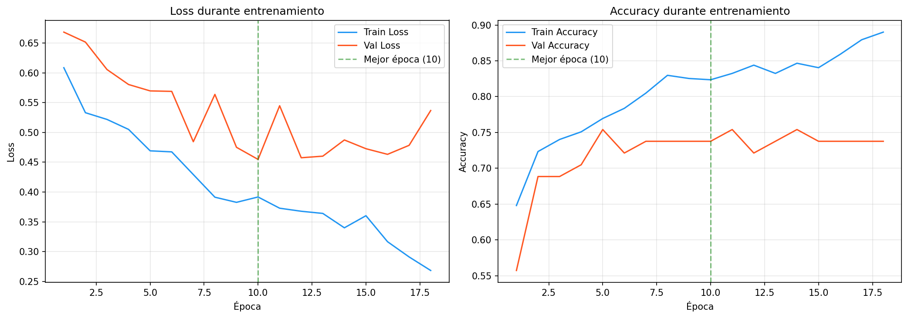
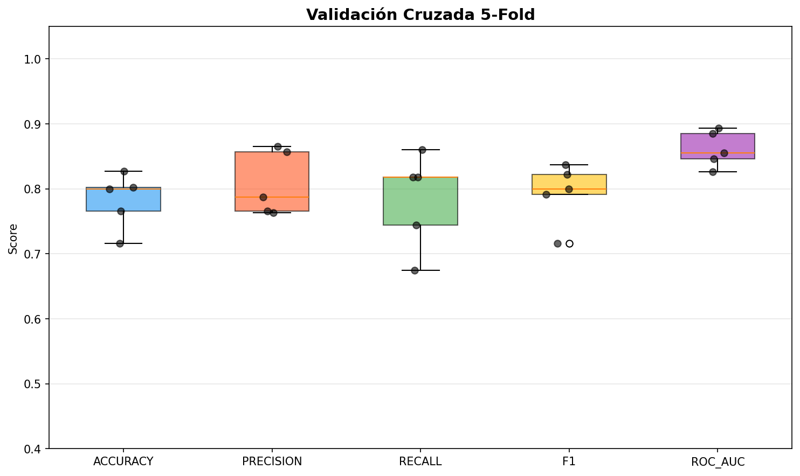

# Informe de Evaluacion: CNN para Deadlift Left

**Fecha de generacion:** 2026-09-15 23:14

---

## 1. Resumen del Dataset

| Metrica | Valor |
|---|---|
| Total de secuencias | 404 |
| Validos (label=1) | 217 (53.7%) |
| Invalidos (label=0) | 187 (46.3%) |
| Shape de datos | (404, 170, 2, 3) |

---

## 2. Arquitectura del Modelo

| Capa | Detalle |
|---|---|
| Conv2D + BatchNorm + ReLU | 32 filtros, kernel 3x3, padding same |
| Conv2D + BatchNorm + ReLU | 64 filtros, kernel 3x3, padding same |
| MaxPool2D | kernel (2, 1) |
| Dropout | 25% |
| Conv2D + BatchNorm + ReLU | 128 filtros, kernel 3x3, padding same |
| Global Average Pooling | Adaptativo (1x1) |
| Dense + ReLU + Dropout | 64 unidades, dropout 50% |
| Dense + Sigmoid | 1 unidad (salida binaria) |

### Hiperparametros

| Parametro | Valor |
|---|---|
| Learning Rate | 0.001 |
| Optimizer | Adam |
| Loss | Binary Cross-Entropy (BCE) |
| Batch Size | 16 |
| Early Stopping Patience | 15 epocas |
| ReduceLROnPlateau | factor 0.5, patience 5 |
| Data Augmentation | 3 aumentaciones por secuencia |
| Normalizacion temporal | 170 frames (percentil 90) |

---

## 3. Curvas de Entrenamiento

### Interpretacion Automatica

- **Mejor epoca:** 10
- **Mejor validation loss:** 0.4548
- **Diagnostico:** OVERFITTING

- El validation loss aumentó mientras el train loss seguía disminuyendo, indicando sobreajuste.
- El sobreajuste comenzó aproximadamente en la época 7.
- Se recomienda aumentar la regularización (dropout, weight decay) o reducir la capacidad del modelo.

---

## 4. Métricas en Test

| Métrica | Valor |
|---|---|
| Accuracy | 0.8361 |
| Precision | 0.8710 |
| Recall | 0.8182 |
| F1-Score | 0.8438 |
| ROC-AUC | 0.9134 |

### Matriz de Confusión

| | Pred: Inválido (0) | Pred: Válido (1) |
|---|---|---|
| **Real: Inválido (0)** | 24 (verdaderos negativos) | 4 (falsos positivos) |
| **Real: Válido (1)** | 6 (falsos negativos) | 27 (verdaderos positivos) |

---

## 5. Validación Cruzada (5-Fold)

| Metrica | Promedio | Desviacion |
|---|---:|---:|
| ACCURACY | 0.7822 | 0.0385 |
| PRECISION | 0.8077 | 0.0444 |
| RECALL | 0.7831 | 0.0660 |
| F1 | 0.7933 | 0.0419 |
| ROC_AUC | 0.8611 | 0.0249 |

---

## 6. Análisis de Errores

### Falsos Positivos (FP) — 4 casos

Predichos como válidos cuando eran inválidos.

| # | video_id | Probabilidad |
|---|---|---|
| 1 | dl_264 | 0.6008 |
| 2 | dl_404 | 0.6908 |
| 3 | dl_412 | 0.9154 |
| 4 | dl_337 | 0.7624 |

### Falsos Negativos (FN) — 6 casos

Predichos como inválidos cuando eran válidos.

| # | video_id | Probabilidad |
|---|---|---|
| 1 | dl_166 | 0.2275 |
| 2 | dl_359 | 0.3448 |
| 3 | dl_169 | 0.1241 |
| 4 | dl_311 | 0.3925 |
| 5 | dl_209 | 0.3495 |
| 6 | dl_212 | 0.4407 |

El listado completo de todas las predicciones se encuentra en `predictions.csv`.
Los errores clasificados están en `misclassified.csv`.

---

## 7. Conclusión General

### Estado Actual del Modelo

- El modelo CNN para clasificación binaria de Deadlift Left alcanzó un **F1-score de 0.8438** y un **ROC-AUC de 0.9134199134199135** en el conjunto de test.
- Se detectaron **10 errores** en el conjunto de test (4 FP, 6 FN).
- El análisis de curvas de entrenamiento indica **OVERFITTING**.

### Recomendaciones

- El modelo tiene un rendimiento aceptable pero con margen de mejora.
- Se recomienda aumentar el dataset y probar técnicas de balanceo de clases (class weights, focal loss).
- Evaluar arquitecturas temporales alternativas y revisar los casos mal clasificados.

---

*Informe generado automáticamente por el pipeline de evaluación.*
