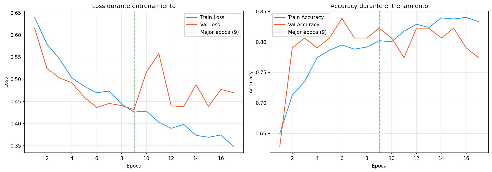
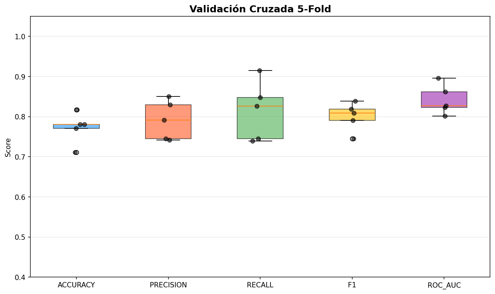

# Informe de Evaluacion: CNN para Deadlift Right

**Fecha de generacion:** 2026-09-15 23:14

---

## 1. Resumen del Dataset

| Metrica | Valor |
|---|---|
| Total de secuencias | 412 |
| Validos (label=1) | 232 (56.3%) |
| Invalidos (label=0) | 180 (43.7%) |
| Shape de datos | (412, 170, 2, 3) |

---

## 2. Arquitectura del Modelo

| Capa | Detalle |
|---|---|
| Conv2D + BatchNorm + ReLU | 32 filtros, kernel 3x3, padding same |
| Conv2D + BatchNorm + ReLU | 64 filtros, kernel 3x3, padding same |
| MaxPool2D | kernel (2, 1) |
| Dropout | 25% |
| Conv2D + BatchNorm + ReLU | 128 filtros, kernel 3x3, padding same |
| Global Average Pooling | Adaptativo (1x1) |
| Dense + ReLU + Dropout | 64 unidades, dropout 50% |
| Dense + Sigmoid | 1 unidad (salida binaria) |

### Hiperparametros

| Parametro | Valor |
|---|---|
| Learning Rate | 0.001 |
| Optimizer | Adam |
| Loss | Binary Cross-Entropy (BCE) |
| Batch Size | 16 |
| Early Stopping Patience | 15 epocas |
| ReduceLROnPlateau | factor 0.5, patience 5 |
| Data Augmentation | 3 aumentaciones por secuencia |
| Normalizacion temporal | 170 frames (percentil 90) |

---

## 3. Curvas de Entrenamiento

### Interpretacion Automatica

- **Mejor epoca:** 9
- **Mejor validation loss:** 0.4316
- **Diagnostico:** OVERFITTING

- El validation loss aumentó mientras el train loss seguía disminuyendo, indicando sobreajuste.
- El sobreajuste comenzó aproximadamente en la época 6.
- Se recomienda aumentar la regularización (dropout, weight decay) o reducir la capacidad del modelo.

---

## 4. Métricas en Test

| Métrica | Valor |
|---|---|
| Accuracy | 0.7419 |
| Precision | 0.8065 |
| Recall | 0.7143 |
| F1-Score | 0.7576 |
| ROC-AUC | 0.7979 |

### Matriz de Confusión

| | Pred: Inválido (0) | Pred: Válido (1) |
|---|---|---|
| **Real: Inválido (0)** | 21 (verdaderos negativos) | 6 (falsos positivos) |
| **Real: Válido (1)** | 10 (falsos negativos) | 25 (verdaderos positivos) |

---

## 5. Validación Cruzada (5-Fold)

| Metrica | Promedio | Desviacion |
|---|---:|---:|
| ACCURACY | 0.7720 | 0.0344 |
| PRECISION | 0.7915 | 0.0438 |
| RECALL | 0.8145 | 0.0661 |
| F1 | 0.8003 | 0.0319 |
| ROC_AUC | 0.8418 | 0.0332 |

---

## 6. Análisis de Errores

### Falsos Positivos (FP) — 6 casos

Predichos como válidos cuando eran inválidos.

| # | video_id | Probabilidad |
|---|---|---|
| 1 | dl_239 | 0.8670 |
| 2 | dl_161 | 0.7993 |
| 3 | dl_389 | 0.5542 |
| 4 | dl_353 | 0.7580 |
| 5 | dl_248 | 0.7779 |
| 6 | dl_386 | 0.8945 |

### Falsos Negativos (FN) — 10 casos

Predichos como inválidos cuando eran válidos.

| # | video_id | Probabilidad |
|---|---|---|
| 1 | dl_406 | 0.4935 |
| 2 | dl_326 | 0.4814 |
| 3 | dl_241 | 0.2565 |
| 4 | dl_335 | 0.1009 |
| 5 | dl_376 | 0.2665 |
| 6 | dl_361 | 0.2971 |
| 7 | dl_348 | 0.4333 |
| 8 | dl_274 | 0.4785 |
| 9 | dl_318 | 0.1623 |
| 10 | dl_368 | 0.4452 |

El listado completo de todas las predicciones se encuentra en `predictions.csv`.
Los errores clasificados están en `misclassified.csv`.

---

## 7. Conclusión General

### Estado Actual del Modelo

- El modelo CNN para clasificación binaria de Deadlift Right alcanzó un **F1-score de 0.7576** y un **ROC-AUC de 0.7978835978835979** en el conjunto de test.
- Se detectaron **16 errores** en el conjunto de test (6 FP, 10 FN).
- El análisis de curvas de entrenamiento indica **OVERFITTING**.

### Recomendaciones

- El modelo tiene un rendimiento aceptable pero con margen de mejora.
- Se recomienda aumentar el dataset y probar técnicas de balanceo de clases (class weights, focal loss).
- Evaluar arquitecturas temporales alternativas y revisar los casos mal clasificados.

---

*Informe generado automáticamente por el pipeline de evaluación.*
