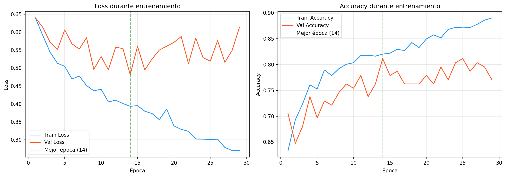
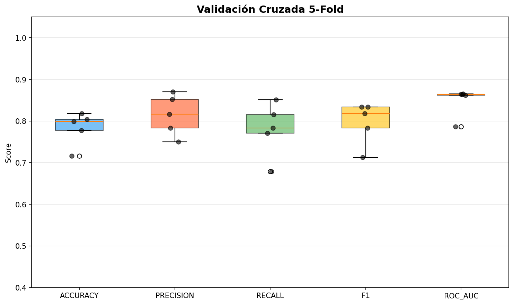

# Informe de Evaluacion: CNN para Deadlift Lateral

**Fecha de generacion:** 2026-09-15 22:09

---

## 1. Resumen del Dataset

| Metrica | Valor |
|---|---|
| Total de secuencias | 816 |
| Validos (label=1) | 449 (55.0%) |
| Invalidos (label=0) | 367 (45.0%) |
| Shape de datos | (816, 170, 2, 3) |

---

## 2. Arquitectura del Modelo

| Capa | Detalle |
|---|---|
| Conv2D + BatchNorm + ReLU | 32 filtros, kernel 3x3, padding same |
| Conv2D + BatchNorm + ReLU | 64 filtros, kernel 3x3, padding same |
| MaxPool2D | kernel (2, 1) |
| Dropout | 25% |
| Conv2D + BatchNorm + ReLU | 128 filtros, kernel 3x3, padding same |
| Global Average Pooling | Adaptativo (1x1) |
| Dense + ReLU + Dropout | 64 unidades, dropout 50% |
| Dense + Sigmoid | 1 unidad (salida binaria) |

### Hiperparametros

| Parametro | Valor |
|---|---|
| Learning Rate | 0.001 |
| Optimizer | Adam |
| Loss | Binary Cross-Entropy (BCE) |
| Batch Size | 16 |
| Early Stopping Patience | 15 epocas |
| ReduceLROnPlateau | factor 0.5, patience 5 |
| Data Augmentation | 3 aumentaciones por secuencia |
| Normalizacion temporal | 170 frames (percentil 90) |

---

## 3. Curvas de Entrenamiento

### Interpretacion Automatica

- **Mejor epoca:** 14
- **Mejor validation loss:** 0.4813
- **Diagnostico:** OVERFITTING

- El validation loss aumentó mientras el train loss seguía disminuyendo, indicando sobreajuste.
- El sobreajuste comenzó aproximadamente en la época 4.
- Se recomienda aumentar la regularización (dropout, weight decay) o reducir la capacidad del modelo.

---

## 4. Métricas en Test

| Métrica | Valor |
|---|---|
| Accuracy | 0.7886 |
| Precision | 0.7692 |
| Recall | 0.8824 |
| F1-Score | 0.8219 |
| ROC-AUC | 0.8398 |

### Matriz de Confusión

| | Pred: Inválido (0) | Pred: Válido (1) |
|---|---|---|
| **Real: Inválido (0)** | 37 (verdaderos negativos) | 18 (falsos positivos) |
| **Real: Válido (1)** | 8 (falsos negativos) | 60 (verdaderos positivos) |

---

## 5. Validación Cruzada (5-Fold)

| Metrica | Promedio | Desviacion |
|---|---:|---:|
| ACCURACY | 0.7829 | 0.0359 |
| PRECISION | 0.8145 | 0.0441 |
| RECALL | 0.7798 | 0.0577 |
| F1 | 0.7960 | 0.0456 |
| ROC_AUC | 0.8483 | 0.0310 |

---

## 6. Análisis de Errores

### Falsos Positivos (FP) — 18 casos

Predichos como válidos cuando eran inválidos.

| # | video_id | Probabilidad |
|---|---|---|
| 1 | dl_147 | 0.9260 |
| 2 | dl_162 | 0.5079 |
| 3 | dl_265 | 0.6611 |
| 4 | dl_295 | 0.6066 |
| 5 | dl_301 | 0.8004 |
| 6 | dl_372 | 0.7391 |
| 7 | dl_560 | 0.9525 |
| 8 | dl_597 | 0.8599 |
| 9 | dl_646 | 0.5867 |
| 10 | dl_660 | 0.9629 |
| 11 | dl_708 | 0.7203 |
| 12 | dl_715 | 0.6300 |
| 13 | dl_732 | 0.5941 |
| 14 | dl_741 | 0.5861 |
| 15 | dl_742 | 0.7276 |
| 16 | dl_759 | 0.6115 |
| 17 | dl_793 | 0.5105 |
| 18 | dl_824 | 0.5126 |

### Falsos Negativos (FN) — 8 casos

Predichos como inválidos cuando eran válidos.

| # | video_id | Probabilidad |
|---|---|---|
| 1 | dl_285 | 0.1377 |
| 2 | dl_302 | 0.2370 |
| 3 | dl_318 | 0.4224 |
| 4 | dl_406 | 0.4785 |
| 5 | dl_433 | 0.0003 |
| 6 | dl_463 | 0.0071 |
| 7 | dl_600 | 0.0254 |
| 8 | dl_725 | 0.2920 |

El listado completo de todas las predicciones se encuentra en `predictions.csv`.
Los errores clasificados están en `misclassified.csv`.

---

## 7. Conclusión General

### Estado Actual del Modelo

- El modelo CNN para clasificación binaria de Deadlift Lateral alcanzó un **F1-score de 0.8219** y un **ROC-AUC de 0.8398395721925135** en el conjunto de test.
- Se detectaron **26 errores** en el conjunto de test (18 FP, 8 FN).
- El análisis de curvas de entrenamiento indica **OVERFITTING**.

### Recomendaciones

- El modelo tiene un rendimiento aceptable pero con margen de mejora.
- Se recomienda aumentar el dataset y probar técnicas de balanceo de clases (class weights, focal loss).
- Evaluar arquitecturas temporales alternativas y revisar los casos mal clasificados.

---

*Informe generado automáticamente por el pipeline de evaluación.*
